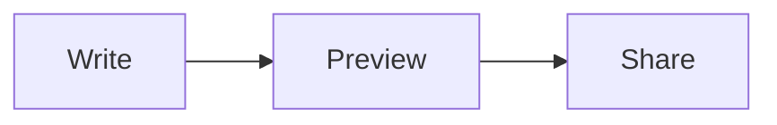

# ZMark


[简体中文](README.zh-CN.md)

[Source code and issues](https://github.com/2716190547/zmark) · [Installers and signed updates](https://github.com/2716190547/zmark-releases)

ZMark is a desktop Markdown editor and reader for local files, with source editing for common code and text files. Write in source mode, read a formatted preview, or work in both views side by side. Organize folders in the sidebar and keep your documents where you choose.

## Download and install

**Current version: 0.2.9** · [Release notes](https://github.com/2716190547/zmark/blob/dev/docs/releases/v0.2.9.md) · [0.2.9 source `033fb5d`](https://github.com/2716190547/zmark/tree/033fb5d7ca478afc06c15d902a7a516d7336e813)

Download from [GitHub Releases](https://github.com/2716190547/zmark-releases/releases/tag/v0.2.9). The [Gitee mirror](https://gitee.com/zeng_sc/zmark-releases/releases) may update later.

| Platform | Package | Install |
| --- | --- | --- |
| macOS (Apple Silicon) | ZIP / DMG | Move `ZMark.app` to Applications. |
| Windows x86_64 | Setup EXE | Run the installer. |
| Linux x86_64 | DEB / tar.gz | Install the DEB or extract the tarball and run `usr/bin/zmark_app`. |

The macOS app is Ad-Hoc signed and is not notarized by Apple. The Windows installer has no publisher code signature. Platform-specific behavior may differ.

## Get started

1. Open a Markdown or supported text file with **Cmd+O** on macOS or **Ctrl+O** on Windows and Linux. You can also start by editing the welcome draft.
2. Choose **Source**, **Split**, or **Preview** in the toolbar. In split view, the two panes scroll together.
3. Open the sidebar with **Cmd+B** or **Ctrl+B**. Drop files or folders into the window to add them to the sidebar. Filter by name, or use a Markdown document’s outline to jump to a heading.
4. Save with **Cmd+S** or **Ctrl+S**. Choose a location the first time you save a draft. Double-click the document title to rename it.
5. Open settings with **Cmd+,** or **Ctrl+,** to adjust appearance, editing, saving, and language.

## Working with documents

### Files and folders

The sidebar groups workspace folders, files opened outside those folders, and drafts. Add folders using the toolbar or drag files and folders from your desktop. Supported files include Markdown, plain text, Rust, Python, JavaScript/TypeScript, C/C++, Java, Go, HTML/CSS, JSON, YAML, TOML, shell scripts, and more. Non-Markdown files open in source mode with language highlighting.

Click a folder row to expand or collapse it; double-click its name to rename. Hold **Shift** for a range, or **Cmd** on macOS / **Ctrl** elsewhere to add or remove individual selections. Use the batch controls in the top-right corner and press **Esc** to leave multiselection. **Remove** hides sidebar items without deleting files; the undo control remains available for five seconds. **Delete** moves items to the system trash and is available through the context menu or batch toolbar.

The sidebar search filters **names**. To search the active document’s contents, click the toolbar search icon or press **Cmd+F** / **Ctrl+F**. Click a result to jump to it. Use **Enter / Shift+Enter** or **F3 / Shift+F3** for the next or previous match; the find input also supports the arrow keys. The outline lists Markdown headings.

Existing files can be saved automatically after editing or when the window loses focus; both behaviors can be configured in settings. A new draft needs a save location before it becomes a file. Unsaved changes are confirmed when closing.

### Markdown and diagrams

The preview supports headings, paragraphs, emphasis, links, lists, task-list markers, tables, quotes, code blocks, local images, and Mermaid diagrams. Fenced code blocks can show syntax highlighting and a copy control. Change a task marker in the source to update its preview.

Use a local path for images, relative to the saved Markdown file or as an absolute path. Network image URLs are not loaded in the preview. Click an image or use a diagram's expand control to inspect it at a larger size.

For example, edit this in split view:

````markdown
# Project notes

- [ ] Review the first draft
- [x] Create a document

| Item | Status |
| --- | --- |
| Preview | Ready |


````

Mermaid syntax support depends on the renderer; if a diagram does not render, check its syntax and simplify the example.

### Export HTML

Choose **Export HTML** in the toolbar or use **Cmd+Shift+E** / **Ctrl+Shift+E**, then choose a destination. The exported HTML includes its styles. Image paths remain references rather than being embedded, and Mermaid blocks are exported as code rather than rendered diagrams; keep referenced images available when sharing the file.

### Appearance and editing

Settings provide light, dark, and system appearance; color palettes; language; reduced motion; line numbers; indentation; line height; and automatic-save options. The application also shows its version and update status in **About**.

## Keyboard shortcuts

| Action | macOS | Windows / Linux |
| --- | --- | --- |
| Open file | Cmd+O | Ctrl+O |
| Save | Cmd+S | Ctrl+S |
| Find in document | Cmd+F | Ctrl+F |
| Next / previous match | F3 / Shift+F3 | F3 / Shift+F3 |
| Undo sidebar removal (within 5 seconds) | Cmd+Option+Z | Ctrl+Alt+Z |
| Exit multiselection / close find | Esc | Esc |
| Source / split / preview | Cmd+1 / 2 / 3 | Ctrl+1 / 2 / 3 |
| Toggle sidebar | Cmd+B | Ctrl+B |
| Settings | Cmd+, | Ctrl+, |
| Export HTML | Cmd+Shift+E | Ctrl+Shift+E |

## Technology

ZMark uses **Rust** and **GPUI** for the desktop app, **pulldown-cmark** for Markdown parsing, **syntect** for code highlighting, and **rusty-mermaid** for diagram rendering. Local images use the Rust `image` crate; large opaque PNG/JPEG previews on macOS use native ImageIO thumbnail decoding. Preview diagrams are rasterized for their display size, and unused textures are released. See the [memory audit](https://github.com/2716190547/zmark/blob/dev/docs/plans/theme-selection-and-memory-audit.md) for measurements and remaining limits; memory use depends on the document, media, and window size.
