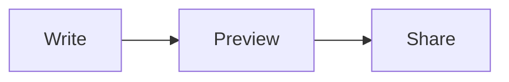

# ZMark


[简体中文](README.zh-CN.md)

ZMark is a desktop Markdown editor and reader for local files. Write in source mode, read a formatted preview, or work in both views side by side. Organize folders in the sidebar and keep your documents where you choose.

## Download and install

Get the latest published version from [GitHub Releases](https://github.com/2716190547/zmark-releases/releases) or the [Gitee release mirror](https://gitee.com/zeng_sc/zmark-releases/releases). The current release provides a macOS ZIP and a Windows installer. Extract the ZIP and move `ZMark.app` to Applications, or run the Windows setup program. Platform-specific behavior may differ.

Linux builds are configured in the project, but the current public release does not include a Linux installer.

## Get started

1. Open a Markdown file with **Cmd+O** on macOS or **Ctrl+O** on Windows and Linux. You can also start by editing the welcome draft.
2. Choose **Source**, **Split**, or **Preview** in the toolbar. In split view, the two panes scroll together.
3. Open the sidebar with **Cmd+B** or **Ctrl+B**. Add a folder to browse its Markdown files, search by file or folder name, or use the document outline to jump to a heading.
4. Save with **Cmd+S** or **Ctrl+S**. Choose a location the first time you save a draft. Double-click the document title to rename it.
5. Open settings with **Cmd+,** or **Ctrl+,** to adjust appearance, editing, saving, and language.

## Working with documents

### Files and folders

The sidebar groups workspace folders, files opened outside those folders, and drafts. You can add more than one workspace folder and create Markdown files inside one. Removing a workspace folder from the sidebar does not delete its files. The search field filters **names**, rather than searching document contents; the outline lists headings in the active document.

Existing files can be saved automatically after editing or when the window loses focus; both behaviors can be configured in settings. A new draft needs a save location before it becomes a file. Unsaved changes are confirmed when closing.

### Markdown and diagrams

The preview supports headings, paragraphs, emphasis, links, lists, task-list markers, tables, quotes, code blocks, local images, and Mermaid diagrams. Fenced code blocks can show syntax highlighting and a copy control. Change a task marker in the source to update its preview.

Use a local path for images, relative to the saved Markdown file or as an absolute path. Network image URLs are not loaded in the preview. Click an image or use a diagram's expand control to inspect it at a larger size.

For example, edit this in split view:

````markdown
# Project notes

- [ ] Review the first draft
- [x] Create a document

| Item | Status |
| --- | --- |
| Preview | Ready |


````

Mermaid syntax support depends on the renderer; if a diagram does not render, check its syntax and simplify the example.

### Export HTML

Choose **Export HTML** in the toolbar or use **Cmd+Shift+E** / **Ctrl+Shift+E**, then choose a destination. The exported HTML includes its styles. Image paths remain references rather than being embedded, and Mermaid blocks are exported as code rather than rendered diagrams; keep referenced images available when sharing the file.

### Appearance and editing

Settings provide light, dark, and system appearance; color palettes; language; reduced motion; line numbers; indentation; line height; and automatic-save options. The application also shows its version and update status in **About**.

## Keyboard shortcuts

| Action | macOS | Windows / Linux |
| --- | --- | --- |
| Open file | Cmd+O | Ctrl+O |
| Save | Cmd+S | Ctrl+S |
| Source / split / preview | Cmd+1 / 2 / 3 | Ctrl+1 / 2 / 3 |
| Toggle sidebar | Cmd+B | Ctrl+B |
| Settings | Cmd+, | Ctrl+, |
| Export HTML | Cmd+Shift+E | Ctrl+Shift+E |

## Technology

ZMark uses **Rust** and **GPUI** for the desktop app, **pulldown-cmark** for Markdown parsing, **syntect** for code highlighting, and **rusty-mermaid** for diagram rendering. Local images are decoded with the Rust `image` crate.
